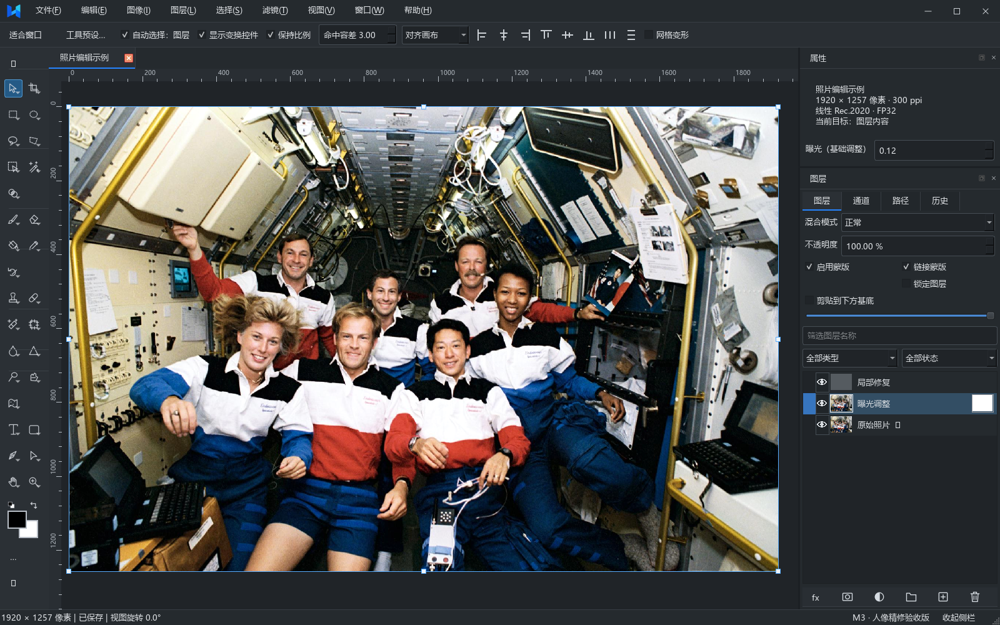
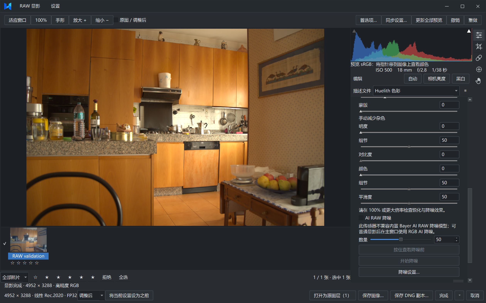
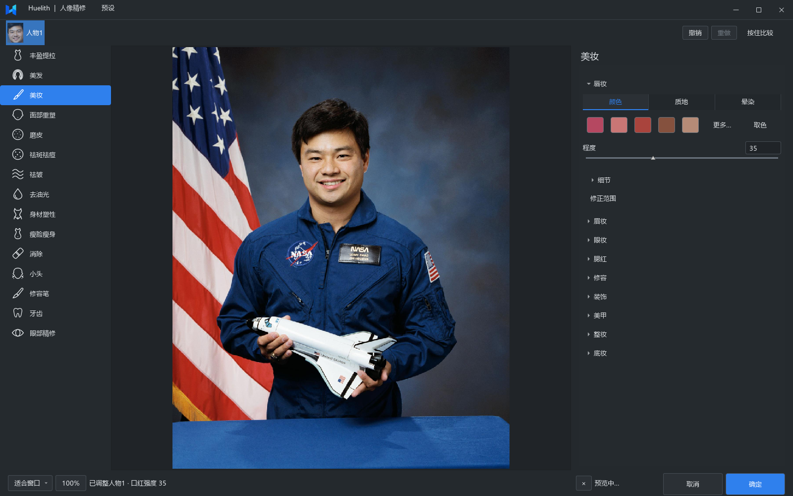
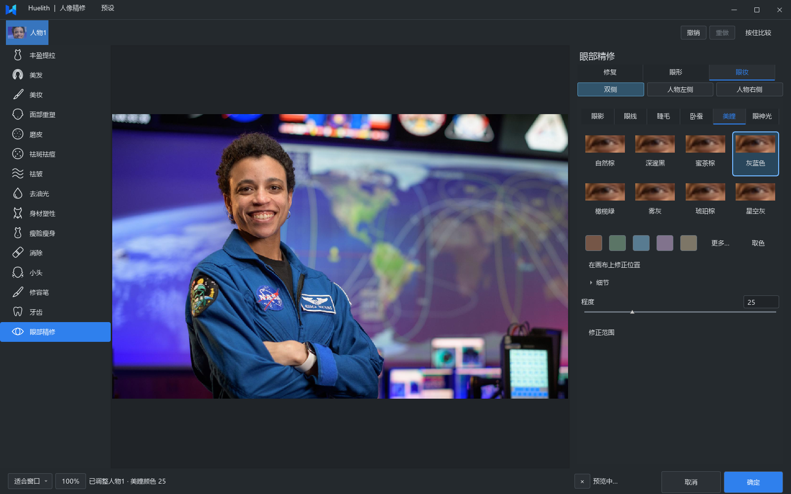

# Huelith

**English** | [简体中文](README.zh-CN.md)

Huelith is a desktop photo editor for Windows with photo editing tools, layer compositing, RAW development, AI image enhancement, and portrait retouching. Use it for photography post-production, portraits, product images, and creative compositions.

The interface supports Simplified Chinese and English. Choose a language during installation, or change it in Preferences under Interface and Workspace. Restart the app to apply the change.

Original project code is licensed under [GNU GPL v3.0 (GPL-3.0-only)](LICENSE). Distributing modified or derivative software based on this code requires providing the corresponding source code under GPL-3.0. Third-party code, models, and assets retain their own licenses.

## Features

### Photo editing and layers

- **Everyday editing:** document size and resolution presets, cropping, rotation, scaling, free transform, perspective adjustments, and mesh warping.
- **Painting and repair:** brushes, erasers, fills, gradients, clone stamp, healing brush, spot healing, patching, dodge and burn, and a dedicated Liquify window.
- **Selections and masks:** rectangular and elliptical selections, lasso, magic wand, object selection, selection refinement, layer masks, and clipping masks.
- **Compositing:** layer groups, blend modes, opacity, layer styles, adjustments, filters, text, shapes, and paths.
- **Layout and workspace:** artboards, slices, frames, layout templates, rulers, guides, grids, and snapping; document tabs, floating windows, resizable sidebars, and saved workspace layouts.
- **Color and output previews:** RGB, grayscale, Lab, and CMYK document settings; ICC profile assignment and conversion, soft proofing, gamut warnings, and printing.
- **Editing preferences:** undo and history, configurable keyboard shortcuts, tool presets, and preferences for cursors, canvas display, units, and caching.



*The main-window screenshot uses a NASA STS-47 onboard crew photo to show photo editing and layer operations in the actual app.*

### RAW development

- Adjust lighting, white balance, curves, the color mixer, calibration, optics, detail, and local masks.
- Open Sony ARW / SR2 / SRF, Canon CRW / CR2 / CR3, Nikon NEF / NRW, Fujifilm RAF (including X-Trans), Panasonic RW2, DNG, and other formats supported by the bundled LibRaw library.
- Standard adjustments preview automatically. AI RAW denoising runs separately; support depends on the sensor pattern and model.
- Export an image or save a DNG copy that retains supported RAW data and development settings, keeping the original file intact.



### AI enhancement and photo merging

- Apply 2× / 4× super-resolution, RGB AI denoising, and depth-based selections to an entire image or a single layer.
- Merge HDR images, stitch panoramas, and stack focus.
- Process, edit, and save images larger than 64 megapixels using tiles.

### Portrait retouching

- **Face and body:** volume and lifting adjustments, face reshaping, body shaping, face and body slimming, head size adjustments, and liquify tools.
- **Skin repair:** smoothing, blemish removal, wrinkle reduction, shine reduction, and local object removal.
- **Makeup and styling:** lips, brows, eyes, blush, contouring, hair color, hair accessories, face decorations, tattoos, and nail art.
- **Teeth and eyes:** teeth whitening and brightening, eye-area repair, eye-white redness reduction, flash red-eye correction, colored contacts, and catchlights.
- Select a person to edit, adjust each side independently, paint manually, refine affected areas, compare before and after, and undo changes.





### Generative workflows with ComfyUI

- Connect to a local or remote ComfyUI service that you manage. ComfyUI is not bundled with Huelith.
- Import workflow JSON and a descriptor file, then configure parameters inside the app for workflows such as inpainting, generative fill, and outpainting.
- Use the current layer, selected layers, or all layers as input, together with selections and masks from the editor.
- View progress, cancel tasks, and retrieve final image candidates. Results are added as new layers, with input layers retained for recovery.
- Check node and model dependencies. Install missing dependencies on the connected ComfyUI service.

### File compatibility and batch processing

- **Projects and images:** editable `.huelith` projects and PNG / JPEG / TIFF export. Batch export supports sizing, naming rules, and presets, with separate export options for layers, artboards, and slices.
- **PSD / PSB:** import and export supported pixel layers, groups, and masks. Some native properties are imported as rasterized appearances; import and export messages describe compatibility limits.
- **PDF:** choose pages and resolution, then import rasterized pages for editing.
- **Automation:** edit and run JSON actions for resizing, exposure, opacity, renaming, conditions, and variables, including batch photo processing.
- **Metadata and credentials:** EXIF borders, metadata export, and C2PA content credential inspection. Signing requires a configured external signing tool.

## Building from source

### Requirements

| Dependency | Requirement |
| --- | --- |
| Operating system | Windows x64 |
| Compiler | Visual Studio 2022 C++ toolchain with C++20 support |
| Build tools | CMake 3.25+ and Ninja |
| Qt | 6.10.3, MSVC x64, including Widgets, Svg, PrintSupport, Network, Concurrent, and WebSockets |
| vcpkg | See `vcpkg.json` for dependencies and the pinned baseline |
| Python | Python 3, used to prepare native inference SDKs |
| Inference runtime | ONNX Runtime DirectML 1.24.4 and DirectML 1.15.4 |

### Prepare resources

The current build also requires model and runtime files that are not included in the repository. Place them at the paths specified in `CMakeLists.txt`:

- `research/m3/openseeface/`: `lm_model3_opt.onnx` and `mnv3_detection_opt.onnx`.
- `research/m3/mediapipe-pose/`: `pose_estimation_mediapipe_2023mar.onnx`.
- `research/m3/mediapipe-person/`: `person_detection_mediapipe_2023mar.onnx`.
- `research/m3/selfie-multiclass/`: `selfie_multiclass.onnx`.
- `research/m2/metadata/runtime/exiftool-13.59_64/`: `exiftool(-k).exe` and `exiftool_files/`.

These files are not yet distributed with the source code. CMake configuration fails if they are missing. RAW denoising, super-resolution, RGB denoising, nail art, and some other features require additional models. A complete model download and resource preparation script is still pending.

### Build commands

Open the source directory in a Visual Studio Developer PowerShell session and set the following environment variables to your installation paths:

```powershell
$env:VCPKG_ROOT = "C:/dev/vcpkg"
$env:QT_ROOT = "C:/Qt/6.10.3/msvc2022_64"

# Download and verify the native ONNX Runtime / DirectML SDKs
python tools/setup_raw_sdk.py

# Configure and build Release
cmake --preset windows-release
cmake --build --preset windows-release --target Huelith
```

The executable is written to `build/windows-release/Huelith.exe`. Keep the accompanying DLLs, Qt plugins, models, and tool directories alongside it when running the app.
