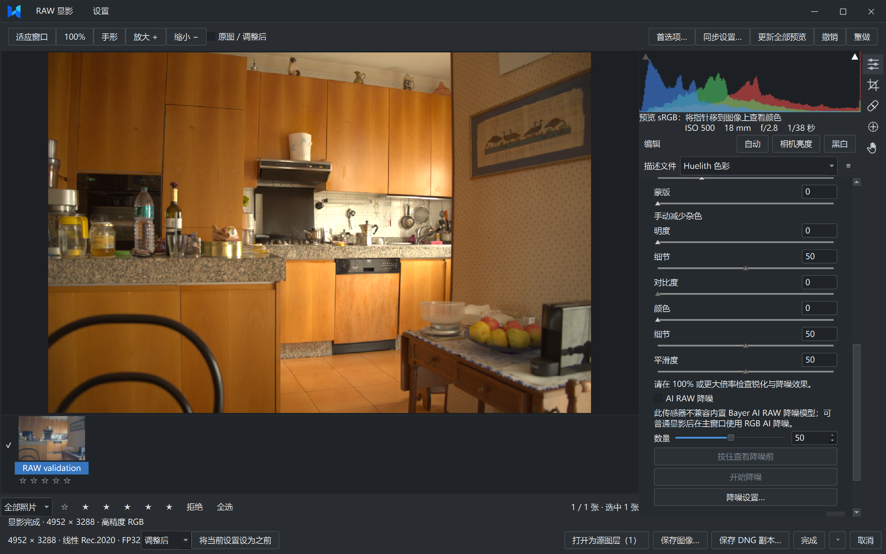
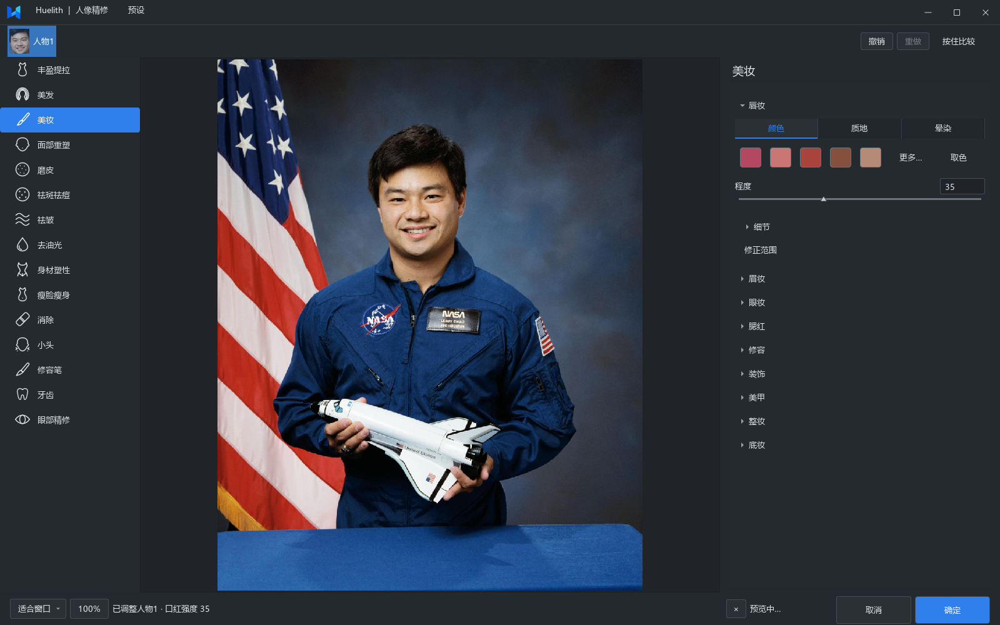

# Huelith

Huelith 是一款面向 Windows 的桌面照片编辑器，提供 RAW 显影、图层合成、AI 图像增强和人像精修，可用于摄影后期、人像修饰、产品图片处理与创意合成。

项目原创代码采用 [GNU GPL v3.0（GPL-3.0-only）](LICENSE)。分发基于这些代码的修改版或衍生软件时，须按 GPL-3.0 提供对应源码。第三方代码、模型和素材沿用各自许可。

## 功能

### RAW 显影

- 光线、白平衡、曲线、色彩混合器、校正、光学、细节与局部蒙版调整。
- 支持 Sony ARW / SR2 / SRF、Canon CRW / CR2 / CR3、Nikon NEF / NRW、Fujifilm RAF（含 X-Trans）、Panasonic RW2、DNG，以及内置 LibRaw 支持的其他格式。
- 普通调整自动预览，AI RAW 降噪单独执行；降噪支持范围取决于传感器排列与模型。
- 导出图片，或转存保留受支持 RAW 数据及显影设置的 DNG 副本，保留原片。



### 图层编辑与图像增强

- 图层、蒙版、混合模式、选区、变换、裁剪、绘画和修复。
- 文字、形状、图层样式、调色与滤镜。
- 整图或单个图层的 2× / 4× 超分、RGB AI 降噪和深度选区。
- HDR 合并、全景拼接与景深合成。
- 超过 6400 万像素的大图分块处理、编辑和保存。
- `.huelith` 可编辑工程，PNG / JPEG / TIFF 输出、批量导出、EXIF 边框及元数据导出。

### 人像精修

- **面部与身材**：丰盈提拉、面部重塑、身材塑性、瘦脸瘦身、小头和液化。
- **皮肤修复**：磨皮、祛斑祛痘、祛皱、去油光和局部消除。
- **美妆与造型**：唇妆、眉妆、眼妆、腮红、修容、染发、发饰、面饰、纹身与美甲。
- **牙齿与眼部**：牙齿去黄和提亮、眼周修复、眼白去红、闪光红眼修正、美瞳与眼神光。
- 选人编辑、左右独立调整、手动画笔、范围修正、前后对比与撤销。




## 源码编译

### 环境

| 依赖 | 要求 |
| --- | --- |
| 系统 | Windows x64 |
| 编译器 | Visual Studio 2022 C++ 工具链，支持 C++20 |
| 构建工具 | CMake 3.25+、Ninja |
| Qt | 6.10.3，包含 Widgets、Svg 和 MSVC x64 组件 |
| vcpkg | 依赖及固定基线见 `vcpkg.json` |
| Python | Python 3，用于准备原生推理 SDK |
| 推理运行时 | ONNX Runtime DirectML 1.24.4、DirectML 1.15.4 |

### 准备资源

当前构建还需要仓库外的模型和运行文件。请按 `CMakeLists.txt` 指定的路径准备：

- `research/m3/openseeface/`：`lm_model3_opt.onnx`、`mnv3_detection_opt.onnx`。
- `research/m3/mediapipe-pose/`：`pose_estimation_mediapipe_2023mar.onnx`。
- `research/m3/mediapipe-person/`：`person_detection_mediapipe_2023mar.onnx`。
- `research/m3/selfie-multiclass/`：`selfie_multiclass.onnx`。
- `research/m2/metadata/runtime/exiftool-13.59_64/`：`exiftool(-k).exe` 和 `exiftool_files/`。

这些文件尚未随源码发布，缺少时 CMake 配置会失败。RAW 降噪、超分、RGB 降噪、美甲等功能还需相应模型。完整模型下载与资源准备脚本待补充。

### 构建命令

在 Visual Studio Developer PowerShell 中进入源码根目录，将以下环境变量改为实际安装路径：

```powershell
$env:VCPKG_ROOT = "C:/dev/vcpkg"
$env:QT_ROOT = "C:/Qt/6.10.3/msvc2022_64"

# 下载并校验 ONNX Runtime / DirectML 原生 SDK
python tools/setup_raw_sdk.py

# 配置并编译 Release
cmake --preset windows-release
cmake --build --preset windows-release --target Huelith
```

程序输出到 `build/windows-release/Huelith.exe`。运行时保留同目录的 DLL、Qt 插件、模型和工具目录。
